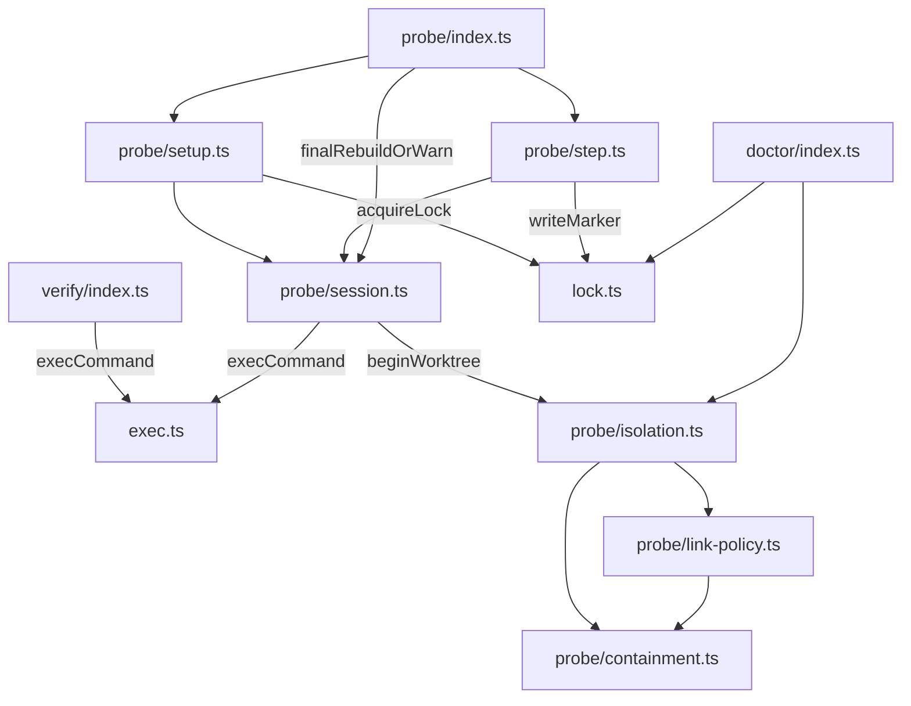

# agent-primitives

Agent-first CLI primitives for narrow subagents: a mutation-probe runner, a
verify runner, a PATH doctor, an identifier-drift guard, a commit-hygiene guard, a bounded-run guard, an all-or-nothing exact-text patcher, checkout snapshot/delta, and linked-worktree creation, removal and
reporting, each returning one bounded JSON result instead of raw tool output.

## Overview

`agent-primitives` is an agent-first CLI: JSON on stdout by default, one
bounded result object per invocation, and stable exit codes (`0` ok, `1`
finding, `2` cannot conclude, including a usage error; `guard` differs, see
[docs/guard.md](docs/guard.md)). It exists to remove a
few recurring failure classes in agent-driven review and implementation work:
hand-edited mutation probes that forget to restore a file, verify output that
blows past a harness's output cap, and "which binary is even on PATH"
guesswork. Unlike its sibling packages, it defaults to JSON output (`-f,
--format text` opts into a human-readable rendering instead), because its
primary caller is another agent, not a terminal. Part of
[agent-dx](https://github.com/LanNguyenSi/agent-dx), playbooks and tooling
for teams shipping with AI agents.

## Key features

- `doctor`: checks a list of required and optional binaries on `PATH`
  (`rg` is required; the default optional list leads with `ast-grep`,
  the structural code-search tool the package's skill names for symbol
  lookups) and reports a few environment signals
  (git worktree, `node_modules`, whether a rebuild is likely needed).
- `verify`: runs named checks (`build`, `typecheck`, `lint`, `test` by
  default) and reports a compact, bounded summary instead of raw output.
- `probe`: runs one mutation probe (or a `--plan` of several), confirms the
  baseline passes first, and reports whether the target test caught the
  mutant, restoring the file afterward either way.
  `--report mutation-probes` prints the run as ready-to-paste
  `mutation_probes` items (the orchestrator implementer contract's eleven
  fields per mutant, merged from the `mutant` record and `mutation_probe`;
  `--replayed` marks them as replays) instead of the JSON envelope.
  A mutant can be a line edit (`-r`, `-M`/`-w`) or a unified diff (`-p/--patch`,
  also `"patch"` in a plan entry): the diff's paths must be `a/` and `b/`
  prefixed and relative to the repository root (not to `-C`), as plain
  `git diff` produces (not `--no-prefix` or `--relative`; such a patch is
  refused with a hint), may touch only the
  `--file` target, and applies the same in `inplace` and `worktree` isolation,
  including when the log directory is inside the checkout.
- `init`: installs the package's own skill document into a harness's skill
  directory.
- `drift`: finds prose and comments that still cite an identifier a change
  deleted or renamed.
- `hygiene`: refuses staged or committed backup files (`*.bak`, `*.orig`,
  `*~`, and the BSD `sed -i` leftovers `*-e`, `*-E`, `*-n`, `*-r`, `*-s`)
  and flags rewrites of extend-only files and dropped test cases.
- `guard`: runs a command under a wall-clock timeout and a memory cap in its
  own process group, kills the whole group at either limit, then finds, kills
  and reports anything the command left running, with a distinct exit code
  for each of timeout, cap and leftovers; for repros, hang probes and fuzz
  loops.
- `patch`: replaces exact text in one or more files from a JSON edit plan
  (or one `--file`/`--old`/`--new` edit), resolving every edit first and
  writing nothing when one is missing, ambiguous or overlapping; reports
  the matching tier per edit, keeps line endings, BOM and file mode, and
  has a `--dry-run` diff preview.
- `snapshot` / `delta`: save checkout/index/content fingerprints to a full
  external artifact and compare the same checkout later.
- `worktree create`: makes a linked worktree on a new branch with no upstream,
  from a chosen base, without touching the main checkout; optionally writes
  the `.ai/run` pointer, symlinks shared dependency directories, runs a setup
  command and a smoke check, and reports the base sha as a ready
  `run-base[<repo>] = <sha>` line.
- `worktree remove`: removes one linked worktree, refusing a dirty, unpushed
  or (with `--require-merged`, optionally against `--base <rev>`) unmerged one
  unless `--force`, unlinking the
  dependency links it finds without ever following them, keeping the branch
  unless `--delete-branch` says otherwise, and never removing or switching the
  main checkout. `--sync-main` then runs `git fetch --prune --no-prune-tags
  origin` and fast-forwards a clean main checkout that is on the default
  branch with no merge, cherry-pick, revert, rebase, `am` or bisect in
  progress (otherwise it reports why it did not); an ignored file at a path
  the fast-forward would add makes it skip before anything is touched, and
  one at a parent path of such a file makes the merge itself fail, the main
  checkout untouched either way.
- `worktree sweep --root <dir> [--dry-run]`: removes every linked worktree
  among the direct children of `<dir>` that is clean, merged into origin's
  default branch (a squash merge counts only when `gh` reports its merged pull
  request at the branch's tip; without `gh` it is skipped) and has commits of
  its own, with its local branch and its ignored files; everything else is
  listed with a reason (a branch without commits of its own, as just created
  or merged by ancestry, is `no_own_commits`). Symlinked children are not
  followed, and a branch that gained a commit while its worktree was removed
  is kept. Exit `0` nothing skipped, `1` something skipped or a branch kept
  (`partial`), `2` refused.
- `worktree list`: reports every worktree of a repository, or every work tree
  below `--root`, with its branch, `.ai/run` pointer, dirty state, commits
  ahead of and behind the default base (or a remote-tracking `--base <rev>`), merge verdict and
  dependency links.
- Non-Node repositories are supported: PHP (PHPUnit, PHPStan,
  PHP_CodeSniffer) output is recognized by `verify` and `probe` alongside
  vitest, tsc, and eslint; `probe`'s zero-tests guard additionally
  recognizes pytest's final summary line (`3 passed in 0.01s` and its
  `no tests ran in 0.00s` zero-tests form).
- Every command accepts the same global flags (`-f/--format`, `-C/--cwd`,
  `-m/--max-chars`, `-l/--log-dir`, and `--json` as an alias for
  `-f json`); see
  [Output shape](docs/output-shape.md) for the JSON envelope and the
  `-m` reduction algorithm.

## Install / quick start

```bash
npx agent-primitives doctor
```

For a binary that stays on `PATH`, so a subagent started as an ordinary
child process finds it too:

```bash
npm install -g agent-primitives
agent-primitives doctor
```

Requires Node >= 20 and git (2.35 or newer for `probe`'s default
worktree isolation; `doctor` reports its `git-version` check ok from
2.36).

## Usage

```bash
agent-primitives probe --file src/foo.js -n 12 -r 'return false;' \
  -t 'npm test'
```

Mutates line 12 of `src/foo.js` to `return false;`, confirms `npm test`
passes first (the baseline), reruns it against the mutant, restores the
file, and reports whether the test caught it (`killed`) or missed it
(`survived`).

## Documentation

- [`doctor`](docs/doctor.md): PATH and environment checks.
- [`verify`](docs/verify.md): run named checks with a bounded summary.
- [`probe`](docs/probe.md): the mutation-probe runner, `--plan`, and the
  result shape.
- [`init`](docs/init.md): install the package's skill into a harness.
- [`drift`](docs/drift.md): the identifier-drift guard for docs and
  comments.
- [`hygiene`](docs/hygiene.md): the commit-hygiene guard for backup files,
  extend-only rewrites and dropped test cases.
- [`patch`](docs/patch.md): all-or-nothing exact-text edits, the matching
  tiers, refusals and the result shape.
- [`guard`](docs/guard.md): bounded runs for repros, hangs and fuzz loops:
  timeout, memory cap, leftovers and the exit codes.
- [`snapshot`](docs/snapshot.md): read-only checkout fingerprints.
- [`delta`](docs/delta.md): compare the same checkout with a saved snapshot.
- [`worktree`](docs/worktree.md): create, list, remove and sweep linked worktrees
  for a task branch, with their flags and refusals.
- [Non-JS test runners](docs/non-js-test-runners.md): PHP and other
  non-Node test runner support, including the "Python bytecode cache"
  section a `probe` warning points to.
- [Output shape](docs/output-shape.md): the JSON envelope, global flags,
  and the `-m/--max-chars` reduction algorithm.

## Architecture

`src/cli.ts` registers every command and sends each result through
`buildEnvelope` in `src/envelope.ts`, which applies the `-m` bound and
maps the status to the exit code. Each command lives in its own module:

| Command | Module |
| --- | --- |
| `doctor` | `src/doctor/index.ts` |
| `verify` | `src/verify/index.ts`, output detectors in `src/verify/detectors/` |
| `probe` | `src/probe/` (`index.ts`, `setup.ts`, `step.ts`, `session.ts`, `isolation.ts` and helpers) |
| `init` | `src/init/index.ts`, digest ledger in `src/init/ledger.ts`; installs `assets/skill/SKILL.md` |
| `drift` | `src/drift/` |
| `hygiene` | `src/hygiene/index.ts`, using `src/drift/git.ts` |
| `patch` | `src/patch/` (`index.ts` plan and write phase, `engine.ts` matching, `hint.ts`, `diff.ts`) |
| `guard` | `src/guard/` (`index.ts` run, limits and sweeps; `ps.ts` the process table), spawning through `src/bounded-spawn.ts` |
| `snapshot`, `delta` | `src/snapshot/` |
| `worktree` | `src/worktree/` (`create.ts`, `remove.ts`, `sweep.ts`, `sync.ts`, `list.ts`; shared git helpers in `git.ts`, the smoke verdict in `readiness.ts`) |

`verify` spawns its checks through `execCommand` in `src/exec.ts`.
`probe` is split into a setup phase (`src/probe/setup.ts`: containment,
lock, stale-marker recovery, worktree preparation, baseline) and a
per-mutant step (`src/probe/step.ts`: in-flight marker, apply, test,
restore, classify), which `--plan` runs once per mutant;
[docs/probe.md](docs/probe.md) shows the order of its gates. Both phases
go through `src/probe/session.ts`: its `runPreThenTest` starts the
baseline's and each mutant's `--pre` and test command through
`execCommand` (the final `--pre` rebuild under `-i inplace` goes
through `runFinalRebuild` in the same module, which `probe/index.ts`
calls through `finalRebuildOrWarn`), and its
`prepareWorktreeSession` creates the `-i worktree` copy through
`src/probe/isolation.ts`. `doctor` reuses `src/lock.ts` and
`src/probe/isolation.ts` to read the markers and scratch worktrees
`probe` leaves behind. The diagram shows the main imports between the
`verify`, `probe` and `doctor` modules and the shared ones; output
helpers that `setup.ts` and `step.ts` also import from `exec.ts` are
left out.



## Development

To work on the package itself, build it from source:

```bash
git clone https://github.com/LanNguyenSi/agent-dx.git
cd agent-dx/packages/agent-primitives
npm install
npm run build
node dist/cli.js doctor
```

`npm test` runs the build first (`pretest`), then the test suite
(vitest). Before pushing, run `npm run typecheck`, `npm run
typecheck:test`, `npm run format:check` and `npm test`; CI runs all of
them for this package (see the repository's
[CONTRIBUTING.md](../../CONTRIBUTING.md)).

Several suites (the guard, process-execution, probe and git-bounds
suites among them) start real processes and deliberately orphan some of
them (a detached grandchild whose parent exits); their teardown kills
every process a case started.
What it cannot do is reap them: a reaped process is reaped by its
parent, and an orphan's parent is PID 1, which node tests are not (and
node has no `waitpid` for foreign pids). In a container run WITHOUT an
init process the killed orphans therefore stay in the process table as
zombies until the container ends; harmless, and gone after it. Run
container test jobs with `docker run --init` (or an equivalent init
reaper) when zombie counts there matter.

## License

MIT
