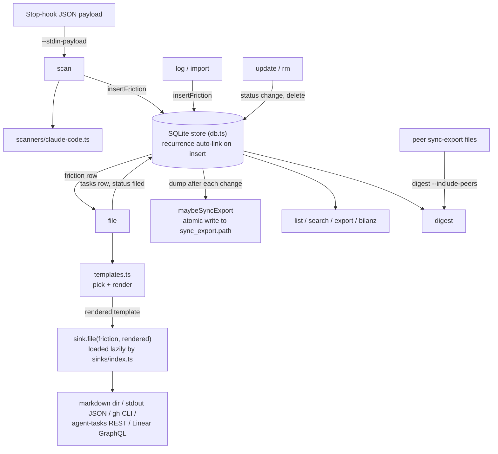

# Design notes

Public-tool framing: zero org-specific-stack assumptions in the core. The default sink is plain markdown files so the tool works without any external infrastructure, and integrations are configurable adapters that load only when used.

Local SQLite, single-user, single-machine at the core. Still no live sync, no server, no cloud: the database itself is never shared or written to remotely. The one opt-in exception is [sync-export](./sync-export.md): a deterministic, config-gated file dump of the local db, plus a read-only merge of other machines' dumps into `digest`. Both are exact no-ops until configured, and transport between machines is left to something else (Dropbox, iCloud, `agent-memory-sync`, ...); this package produces and consumes a file, it does not move it. Friction records are personal observation data, the smallest store that lets queries answer questions is the right one.

Deterministic detection only: regex on tool-call errors, non-zero exits, friction phrases. No LLM API calls in the default Stop-hook so it stays free and fast. An opt-in `--with-llm` mode for end-of-week reviews is a future idea (see [What's next](#whats-next)).

## How the pieces connect

The source is split into a few modules:

- `commands/`: one file per subcommand; `main.ts` wires them into the CLI.
- `scanners/` (transcript adapters, `claude-code.ts` today), `sinks/` (filing targets, loaded lazily by `sinks/index.ts`), `templates.ts` (template pick and render).
- `db.ts` (SQLite store, recurrence auto-link on insert), `config.ts` (config file loading), `paths.ts` (XDG paths and env overrides).

The flowchart shows the capture paths into the local SQLite store, the filing path through templates and sinks, the read commands, and the optional sync-export write-through and peer merge.

Every mutating command (`log`, `scan`, `import`, `file`, `update`, `rm`) calls `maybeSyncExport` after it changes the store; it is a no-op until `sync_export` is configured. See [Sinks](./sinks.md), [Storage](./storage.md) and [Sync-export](./sync-export.md) for each piece.

## ADR: FileOptions widening

The pre-M4 `FileOptions { sinkTarget?: string }` was too narrow for sinks that need a project id, an api base, a team id, etc. Three options were considered (per the M4 task description):

- **A. Discriminated union per sink.** Strictest, but every sink change becomes a type bump in `types.ts`; doesn't compose with config files cleanly.
- **B. Open `Record<string, unknown>` bag validated per sink.** Flexible, forward-compatible CLI, but loses the type-level guarantee that a given key exists.
- **C. Drop CLI options entirely, read everything from `config.yml`.** Simplest CLI, but blocks one-off `--sink-opt repo=other/repo` overrides that are convenient when scripting.

**Shipped: B with a config-file layer.** Each sink reads `opts.sinkOpts`, which is the merge of the per-sink section in `config.yml` and any `--sink-opt key=value` CLI overrides (CLI wins on collision). Each sink validates the keys it cares about and surfaces missing-required-key with a single-line error pointing at both the config path and the equivalent `--sink-opt` flag. Unknown keys pass through untouched so a forward-compatible CLI does not fail against an older sink build. The C option (drop CLI options entirely) was rejected because `--sink-opt repo=other/repo` overrides are convenient when scripting one-off file calls.

## What's next

The v1 surface is complete. Future ideas (no scheduled milestone): web dashboard, vector-based recurrence detection, additional import formats (github-issues, agent-tasks backfill), `digest --with-llm` for end-of-week reviews.

## Where this fits

`friction-log` and `slop-detector` are sibling hygiene tools in the agent-dx workshop. `slop-detector` catches prose tells at PR time. `friction-log` catches workflow tells at session time. Both run cheaply, both produce a structured artifact, both compose with whatever issue tracker and review process the team already uses.
