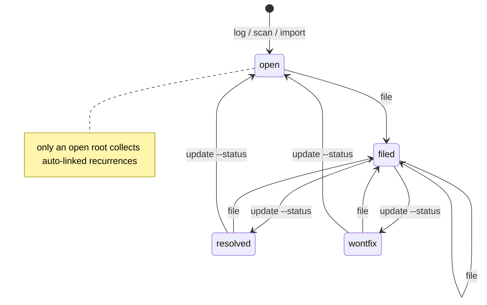

# Storage

SQLite under `~/.local/share/friction-log/db.sqlite` (XDG-compliant). Override with `FRICTION_LOG_DB=/path/to/db.sqlite` or `--db /path/to/db.sqlite` per command.

Schema (M1): `sessions`, `frictions` (plus FTS5 virtual table), `tasks` (records what was filed to which sink), `tags`, `schema_version`.

Schema v2 (M3): adds `CHECK(severity IN ('low','medium','high','critical') OR severity IS NULL)` to `frictions`. On upgrade the migration normalizes any rogue severity values to `NULL` before swapping the table in, so existing rows survive. The FTS5 virtual table and triggers are recreated against the new physical table.

## Friction status lifecycle

A friction has one of four statuses: `open`, `filed`, `resolved`, `wontfix`.

- `log`, `scan` and `import` insert new frictions as `open`.
- `file` sets `filed` after the sink call succeeds. It does not check the current status: filing the same friction again records another `tasks` row and leaves it `filed`.
- `update --status` sets any of the four statuses from any other; there are no transition rules.
- `rm` deletes the friction together with its `tasks` and `tags` rows. Frictions that recorded it as their `recurrence_of_id` are kept and get that reference cleared (set to `NULL`), so they become roots; they are not re-pointed to a grandparent. For a chain A <- B <- C, deleting B leaves A and C, with C's `recurrence_of_id` cleared.

Only an open root collects auto-linked recurrences (see below), so once a root is filed, resolved or wontfix, the next matching friction starts a new chain.

The diagram shows the commands that set each status. `file` sets `filed` from any status, and `update --status` can also move between any two statuses, including moves not drawn here such as `open` to `resolved`.

## `recurrence_of_id` semantics

When `log`, `scan` or `import` inserts a new friction without an explicit recurrence id (`log --recurrence-of`), the database looks for an existing friction that is:

1. `status = 'open'`,
2. itself a root (`recurrence_of_id IS NULL`),
3. with the same `tool_surface`,
4. and the same `title` (exact match).

The oldest such match becomes the new friction's `recurrence_of_id`. The chain therefore always points one level deep, at the root; downstream queries can `GROUP BY coalesce(recurrence_of_id, id)` to fold recurrences into their root for free.

This is the cheap, deterministic rule, deliberately small enough to predict by eye. A future milestone may add fuzzier matching (template-aware, vector-based) behind an opt-in flag, but the cheap rule is the default so the database remains explainable from a glance at the source.
