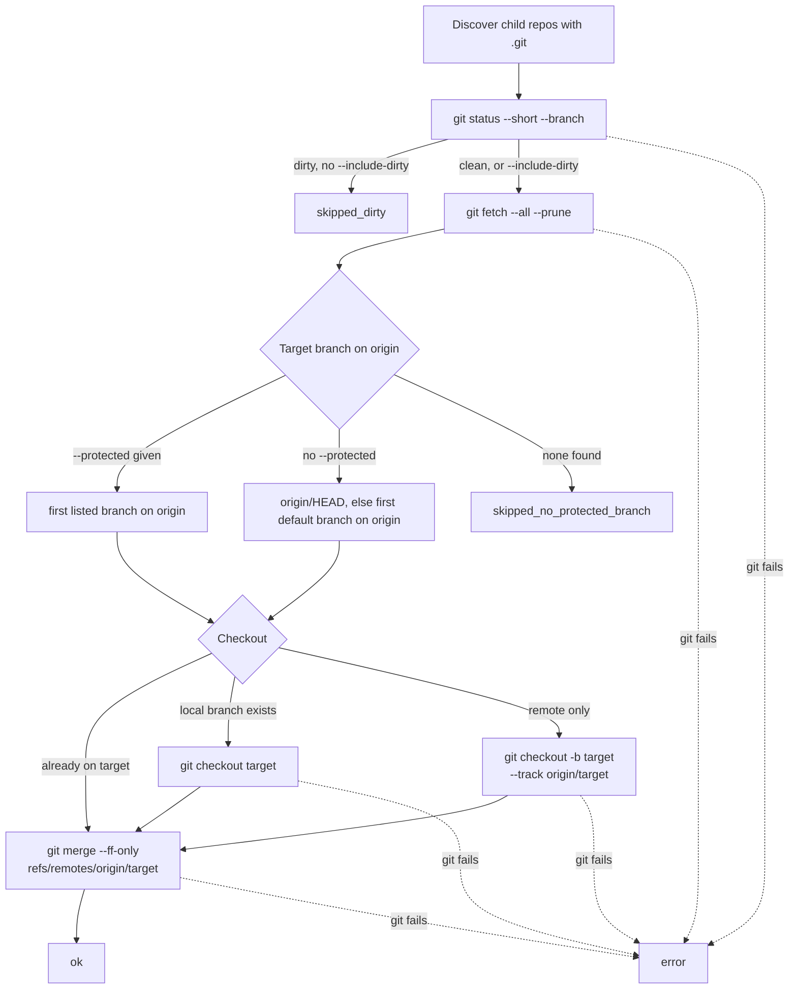

# Command reference

## `sync`

`sync` is the default command: `git-batch` runs `sync` in the current directory, and `git-batch <root>` runs it in `<root>`. Run `git-batch status <root>` or add `--dry-run` to preview first.

Checks all repositories on one level, skips dirty repositories by default, switches to the protected branch, and fast-forwards it with `git merge --ff-only`. Repositories are processed in parallel (default 8 at a time, see `--concurrency`).

```bash
git-batch sync ~/git
git-batch sync ~/projects
git-batch sync ~/git --only api,worker
git-batch sync --protected main,develop --dry-run
```

Default `sync` flow: read `git status`; a dirty repository is skipped without fetching unless `--include-dirty` is passed; otherwise `git fetch --all --prune`, detect the protected target branch, switch to it, then `git merge --ff-only refs/remotes/origin/<target>` (fully qualified, so a local branch or tag named `origin/<target>` cannot shadow it). The merge uses the refs the fetch just updated, so each repository makes one network roundtrip instead of two (`git pull` would fetch again). Steps within one repository stay sequential; repositories run in a bounded parallel pool and the results keep the sorted repository order, not completion order. If `remote.origin.skipFetchAll` is set, or no `remote.origin.fetch` refspec maps `refs/heads/<target>` to `refs/remotes/origin/<target>`, `git fetch --all` would leave that ref stale; for such repositories `sync` first runs `git fetch origin +refs/heads/<target>:refs/remotes/origin/<target>` (one extra roundtrip, only for these configurations) and records it in `actions`. Linked worktrees of one repository share a ref store, so the network fetch runs once per git common directory: the first worktree in sorted order that is not skipped runs it, the others list the same command in `actions` with `skipped: true` and `sharedWith: <repo>`, wait for it, and then do their own checkout and merge. If the shared fetch fails, its siblings fail with the same message. In text output a shared action is printed with a suffix, for example `git fetch --all --prune (shared with main-wt)`. A sibling cannot check out a branch that another worktree already holds; that git error is reported for it as before. If `--protected` is given, that explicit branch order replaces `origin/HEAD` and the default branch list; explicitly configured protected branches must exist on `origin` (local-only branches are not selected as fast-forward targets).

The per-repository path of `sync` (see [Branch detection](#branch-detection) and [Outcomes and exit codes](#outcomes-and-exit-codes)):



With `--dry-run`, fetch, checkout and merge are recorded in `actions` but not run, so detection uses the refs from the last real fetch.

## `status`

Shows the current branch, detected target branch, upstream tracking branch, ahead/behind distance, and change counters for every repository.

```bash
git-batch status ~/git
git-batch status ~/git --fetch          # fetch first so distances reflect origin now
git-batch status ~/git --fetch --json   # structured output for scripts / agents
```

Per-repo JSON fields added beyond the base shape:

- `upstream`: the tracking branch name (e.g. `origin/master`), or `null` when the current branch has no upstream configured (new local branch, detached HEAD).
- `ahead`: commits on the current branch not yet on the upstream. `null` when there is no upstream.
- `behind`: commits on the upstream not yet on the current branch. `null` when there is no upstream.

`ahead`/`behind` are computed against the **local** copy of the upstream ref. Without `--fetch` they can be stale, the check is only as fresh as the last `git fetch`. Pass `--fetch` (or run `git-batch fetch ~/git` beforehand) to force a refresh.

### `--fetch` error handling

`--fetch` runs `git fetch --quiet` per repository. If a single repo's fetch fails (network error, unreachable remote, bad credentials), its entry is tagged `outcome: "fetch_failed"` but the batch continues. The remaining status fields still come from whatever refs happen to exist locally, so you get partial information instead of a hard stop.

A repo with no remote configured at all is not a fetch failure: `git fetch --quiet` exits 0 silently, and `outcome` stays `ok`.

### `--fetch` performance

`--fetch` runs repository fetches with a bounded parallel pool of 8 concurrent fetches by default; `--concurrency <n>` changes the pool size. On large trees this keeps status fresh enough for hook-driven workflows without changing the per-repo result shape.

### Text output shape

The plain-text `status` row inserts the new columns between `target=…` and `clean=…`, it is not a pure append:

```
<repo>: branch=X target=Y upstream=U ahead=D behind=E clean=Z staged=… unstaged=… untracked=… [outcome=F]
```

The `-` sentinel is reused for `upstream=-`, `ahead=-`, `behind=-` when the current branch has no upstream. Scripts using `key=value` parsing are unaffected; scripts that index columns positionally should switch to `--json`.

## `dirty`

Shows only repositories that currently have local changes.

```bash
git-batch dirty ~/git
```

## `fetch`

Runs `git fetch --all --prune` for each repository, in a bounded parallel pool (default 8, see `--concurrency`). Results keep the sorted repository order. Linked worktrees of one repository share their refs, so the fetch runs once per git common directory; the other worktrees show the command in `actions` with `skipped: true` and `sharedWith: <repo>`. `status --fetch` shares fetches the same way.

```bash
git-batch fetch ~/git
```

## `branches`

Shows the current branch and the detected protected branch for each repository.

```bash
git-batch branches ~/git
```

## `list`

Lists all discovered repositories on the current level.

```bash
git-batch list ~/git
```

## Options

- `--root <path>`: explicitly set the root folder to scan (defaults to cwd)
- `--protected <a,b,c>`: try only these branches, in order, as the target branch (replaces `origin/HEAD` and the default list, see [Branch detection](#branch-detection))
- `--only <a,b,c>`: include only matching repository names
- `--exclude <a,b,c>`: exclude matching repository names
- `--include-current`: include the current folder if it is a Git repository itself
- `--include-hidden`: scan hidden child directories as well
- `--include-dirty`: allow `sync` to continue even when a repository has local changes
- `--strict`: return a non-zero exit code for actionable problem states
- `--dry-run`: for `sync` and `fetch`, list the Git commands that would change repositories without running them (read-only checks still run). `status --fetch` still fetches.
- `--json`: emit JSON instead of plain text
- `--fetch`: for `status`, run `git fetch --quiet` per repo before computing ahead/behind
- `--concurrency <n>` (also `--concurrency=<n>`): number of repositories processed in parallel by `sync`, `fetch` and `status --fetch`; a positive integer, default 8. A bare `--concurrency` without a value fails with `Missing value for --concurrency`; any other non-positive-integer value fails with `Invalid value for --concurrency`. Very large values are not capped and can hit the open-file limit (each in-flight fetch holds several descriptors), so keep it modest.

## Repository filters

`--only` and `--exclude` apply to all commands.

- plain values are treated as case-insensitive substring matches
- regex literals are supported in JavaScript form, for example `'/^api-/'`
- multiple patterns are comma-separated

Examples:

```bash
git-batch status ~/git --only api,worker
git-batch dirty ~/git --exclude legacy,archive
git-batch sync ~/git --only '/^(api|web)-/' --exclude '/-sandbox$/'
```

## Branch detection

Without `--protected`, the target is `origin/HEAD`, else the first existing branch from `main, master, develop, dev, staging, production, trunk`. With `--protected`, only the given list is tried, in order; `origin/HEAD` and the default list are not consulted. If none of the listed branches exists, no target is detected: `branches` shows `target=-` and `sync` reports `skipped_no_protected_branch`. For `sync` a branch counts only if it exists on `origin`; `status` and `branches` also accept a local branch.

## Output model

The CLI reports, per repository: current branch, detected target branch, whether the worktree is clean, and counts for `staged`, `unstaged`, and `untracked`. This makes it easier to spot repositories that would be skipped by `sync`.

## Agent and automation use

The CLI is safe for non-interactive use and keeps repository ordering deterministic.

For agents and CI jobs, prefer:

```bash
git-batch status /path/to/workspace --json --strict
git-batch dirty /path/to/workspace --json --strict
git-batch sync /path/to/workspace --json --strict --dry-run
```

Why this works well:

- `--json` returns structured output with `command`, `root`, `strict`, `repoCount`, `exitCode`, and `results`
- `--strict` turns actionable states into a non-zero exit code
- no interactive prompts are required
- output order is stable because repositories are sorted by name

Recommended interpretation:

- `status --json --strict`: fail if any repository is dirty
- `dirty --json --strict`: fail if any repository has local changes
- `sync --json --strict`: fail if any repository is skipped or errors
- `branches --json --strict`: fail if any repository has no detected target branch

With `--strict`, an empty result set stays exit code `0`. This keeps filtered runs such as `--only` stable for automation.

### Outcomes and exit codes

Each entry in `results` has an `outcome`:

| `outcome` | Commands | Meaning |
| --- | --- | --- |
| `ok` | all | succeeded |
| `error` | `sync`, `status`, `fetch`, `dirty` | a Git command failed or the repository could not be read; the message is in `error` |
| `fetch_failed` | `status --fetch` | the fetch failed; the other fields come from local refs |
| `skipped_dirty` | `sync` | local changes, nothing run; `reason` is `worktree_dirty` |
| `skipped_no_protected_branch` | `sync` | no target branch on `origin`; `reason` is `no_remote_protected_branch_detected` |

Any `error` outcome exits 1, with or without `--strict`. With `--strict`, `sync` also exits 1 on any skipped repository, `status` on any dirty repository, `dirty` on any listed repository, and `branches` on any repository without a detected target branch. `fetch_failed` does not change the exit code.

## Open source files

This repository includes the usual project governance files: `LICENSE`, `CONTRIBUTING.md`, `CODE_OF_CONDUCT.md`, `SECURITY.md`.

## Roadmap

Not yet implemented; no scheduled milestone:

- support for a workspace config file such as `.git-batch.json`
- an optional confirmation prompt before batch `sync` without `--dry-run`
