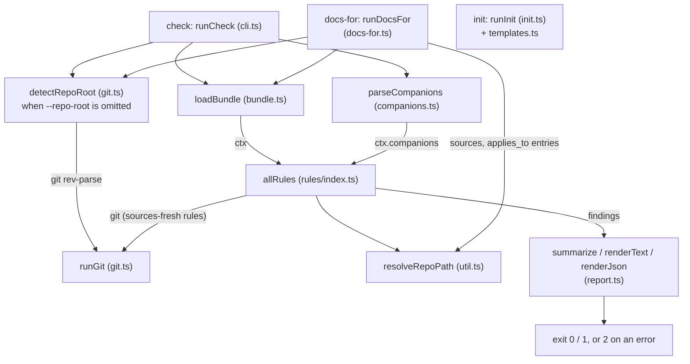

# okf-kit

CLI that validates OKF v0.1 knowledge bundles for structural correctness, staleness, and citation drift.

Part of [agent-dx](https://github.com/LanNguyenSi/agent-dx), playbooks and tooling for teams shipping with AI agents.

## Overview

`okf-kit` checks knowledge bundles against the [Open Knowledge Format (OKF) v0.1 spec](https://github.com/GoogleCloudPlatform/knowledge-catalog/blob/main/okf/SPEC.md), a shape for markdown-plus-frontmatter knowledge bundles meant to be readable by both humans and agents. The check catalog was shaped by the Phase-0 OKF pilot in agent-tasks ([PR #385](https://github.com/LanNguyenSi/agent-tasks/pull/385)), where a few structural mistakes (bad links, absolute paths) turned out to be easy to make and easy to catch mechanically.

It validates frontmatter shape, link resolution, staleness against git history, and citation drift (a `path:N` citation whose line numbers shifted under it); `init` scaffolds a starter bundle and `docs-for` answers "which docs claim this source path".

`okf-kit` is the producer-side check: it validates a bundle you are authoring or maintaining. Consuming a bundle at query time (loading, indexing, ranking passages for an agent) lives in [codebase-oracle](https://github.com/LanNguyenSi/codebase-oracle), a separate tool.

## Key features

- 10 rules covering frontmatter shape, reserved files, link resolution, and staleness/citation drift assessed against git history; see the [check catalog](docs/check-catalog.md).
- `init` scaffolds a starter bundle: `index.md`, `log.md`, and one template doc per concept type.
- `docs-for` reverse lookup: given one or more changed paths, which bundle docs claim them as `sources` or `applies_to` (a lookup-only field that `sources-fresh` ignores).
- A citation can carry an anchor (`#heading` or `#"text"`) so a `path:N-M` citation survives content moving above it; see [Citation resolution](docs/citations.md).
- `--dirty-as-now` makes a pre-commit `check` run report the same staleness verdict CI reports after the commit lands; see [Staleness](docs/staleness.md).
- `--require-anchors` and `--prose-line-references` opt into stricter checks for a bundle whose citations are already anchored.

## Install

```bash
# one-off, no install
npx okf-kit check path/to/bundle

# or install it
npm install -g okf-kit
```

Requires Node >= 20, and `git` on the PATH for repo-root auto-detection and for the staleness rules, which read commit history; see the [check catalog](docs/check-catalog.md#repo-root-auto-detection) for what runs without it.

The README on the default branch can describe options that are not yet published to npm; `CHANGELOG.md`'s `[Unreleased]` section lists them.

## Usage

```bash
okf-kit check path/to/bundle

# explicit repo root, used for sources-shape existence checks, staleness
# checks and citation checks (see docs/check-catalog.md's "repo-root
# auto-detection" for what happens when you omit this)
okf-kit check path/to/bundle --repo-root /path/to/repo

# JSON output for tooling (format: docs/check-catalog.md's "Output")
okf-kit check path/to/bundle --json

# fail on warnings too, not just errors (STALE and FUTURE-DATED findings are warnings)
okf-kit check path/to/bundle --strict

# resolve frontmatter refs like `shipped:runbooks/r.md` into another bundle (repeatable);
# add --skip-companion-refs to report an unpassed alias as a notice instead of an error
okf-kit check path/to/bundle --companion shipped=path/to/other/bundle

# report only some rules and/or a minimum severity (the exit status counts only what is reported)
okf-kit check path/to/bundle --rule citations-resolve,links-resolve --min-severity warning
```

`check` exits `0` with no errors (and, under `--strict`, no warnings), `1` when it finds one, and `2` on an invocation or tool error; see [check catalog](docs/check-catalog.md#exit-codes) for the full table and [Output](docs/check-catalog.md#output) for the text and JSON formats.

Other commands:

```bash
# scaffold docs/okf (the default target, relative to the current directory)
okf-kit init

# which docs claim src/foo.ts (or a directory it lives under) as a source?
okf-kit docs-for path/to/bundle src/foo.ts
```

See [Scaffold a bundle](docs/init.md) and [Reverse lookup](docs/docs-for.md) for the full command reference, including flags and output formats.

### Use in CI

Pin the exact version and use a full (non-shallow) checkout; [CI usage](docs/ci.md) explains why:

```yaml
- uses: actions/checkout@v5
  with:
    fetch-depth: 0
- name: OKF bundle check
  run: npx okf-kit@0.18.0 check path/to/bundle
```

## Documentation

- [Check catalog](docs/check-catalog.md): all 10 rules, repo-root auto-detection, exit codes, output format.
- [Scaffold a bundle (`init`)](docs/init.md): generated files, placeholder sources, authoring guidance.
- [Reverse lookup (`docs-for`)](docs/docs-for.md): matching rules, path resolution, output formats.
- [Staleness (`sources-fresh`)](docs/staleness.md): the re-stamp rule, designator-less timestamps, squash-merge interaction, `--dirty-as-now`, `sources-fresh-future`.
- [Citation resolution (`citations-resolve`)](docs/citations.md): every finding id, anchor forms, continuation and short-form citations, `--require-anchors`.
- [Prose line references](docs/prose-line-references.md): the opt-in `--prose-line-references` check for line numbers written outside `citations-resolve`'s own grammar.
- [CI usage](docs/ci.md): shallow-clone caveats, the pinned-version rationale, the template's pin, and the `templates/okf-staleness.yml` warn-only workflow template.

## Development

```bash
npm install
npm run build
npm test
```

See [`../../CONTRIBUTING.md`](../../CONTRIBUTING.md) for issue and PR conventions, and the release process (including `CONTRIBUTING.md`'s "Releasing okf-kit" section for bumping this repo's own `okf-kit@<version>` pins).

### Architecture

Modules under `src/`:

- `cli.ts`: the `check`, `docs-for` and `init` commands, `runCheck`, and the mapping of results and errors to exit codes.
- `bundle.ts`: `loadBundle` walks the bundle's `*.md` files and parses their frontmatter (`parseFrontmatter`).
- `rules/`: one file per rule (`sources-fresh.ts` holds both `sources-fresh` and `sources-fresh-future`); `rules/index.ts` registers them in `allRules`.
- `report.ts`: `summarize`, and the text (`renderText`) and JSON (`renderJson`) output of `check`.
- `git.ts`: `runGit`, the git child-process wrapper, and `detectRepoRoot`.
- `util.ts`: frontmatter `sources`/`applies_to` getters, `resolveRepoPath`, and `timestamp` parsing.
- `links.ts`: `extractMarkdownLinks`, shared by `links-resolve` and `no-absolute-links`.
- `companions.ts`: `--companion` parsing (`parseCompanions`).
- `docs-for.ts`: `runDocsFor` and its text and JSON output.
- `init.ts` and `templates.ts`: `runInit` and the scaffolded file bodies.
- `types.ts`: the shared types (`Finding`, `Rule`, `BundleContext`, `RunGit`); `errors.ts`: `UsageError`.

The diagram shows how `check` and `docs-for` share repo-root detection, bundle loading and path resolution, where the rule registry and the exit code sit, and that `init` (registered in `cli.ts` like the other two commands) stands apart: it only writes the `templates.ts` bodies.



To add a rule:

1. Implement `Rule` (`id`, `description`, `run(ctx)`) in `src/rules/<id>.ts`.
2. Register it in `allRules` in `src/rules/index.ts` and add its id to `test/rules-registry.test.ts`.
3. For an opt-in rule: add a `CheckOptions` field and a commander option in `cli.ts` and a `BundleContext` field in `types.ts`, copy the option onto `ctx` in `runCheck`, and return `[]` from `run()` when it is unset.
4. Add a row to the [check catalog](docs/check-catalog.md) and update the rule count in this README (Key features and Documentation).

## License

MIT, see [LICENSE](../../LICENSE) at repo root.
