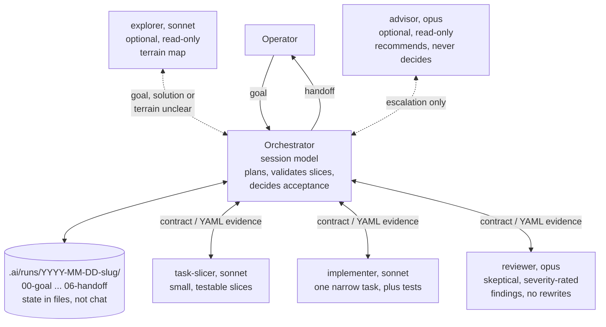

# Architecture: why this shape

The orchestrator/subagent loop `orchestrator-workflow` installs, and the
reasoning behind it. See the [package README](../README.md) for installation
and day-to-day usage.

The diagram shows the operator, the orchestrator, the run directory it keeps
state in, and the five subagent roles of the default `full` profile with the
model each one gets by default on Claude Code and opencode.

The `minimal` profile installs only the implementer and the reviewer. The
advisor is consulted only at escalation triggers and returns a recommendation;
the orchestrator still decides (see
[Role profile reference](role-profile-reference.md)). The model names shown
are the Claude Code and opencode defaults; Codex routes the same roles through
the table in [Model routing reference](model-routing-reference.md#codex-defaults).

Two effects fall out of this shape:

- **Token efficiency.** The orchestrator's context stays small: subagents
  receive narrow task contracts instead of the whole conversation, return
  structured YAML evidence instead of transcripts, and durable state lives
  in run files that survive context compaction. The cheap models do the
  volume work; the strongest model is spent only on orchestration decisions
  and the skeptical review. The ceremony scales to the task: a trivial change
  is done directly, the full flow is for non-trivial work, and a read-only
  explorer maps the terrain first only when the solution is unclear. When
  available, the explorer prefers each of a repo's configured knowledge
  bundles (`knowledge` in `.ai/workflow/manifest.json`; default `docs/okf/`)
  or a connected semantic code-search tool over hand-mapping terrain with
  grep.
- **Quality through structure.** Writing and reviewing are separated by
  role and model, task slices are validated before any implementation
  starts, acceptance is decided on evidence (tests executed, findings
  addressed), and every run leaves an auditable trail in `.ai/runs/`.
