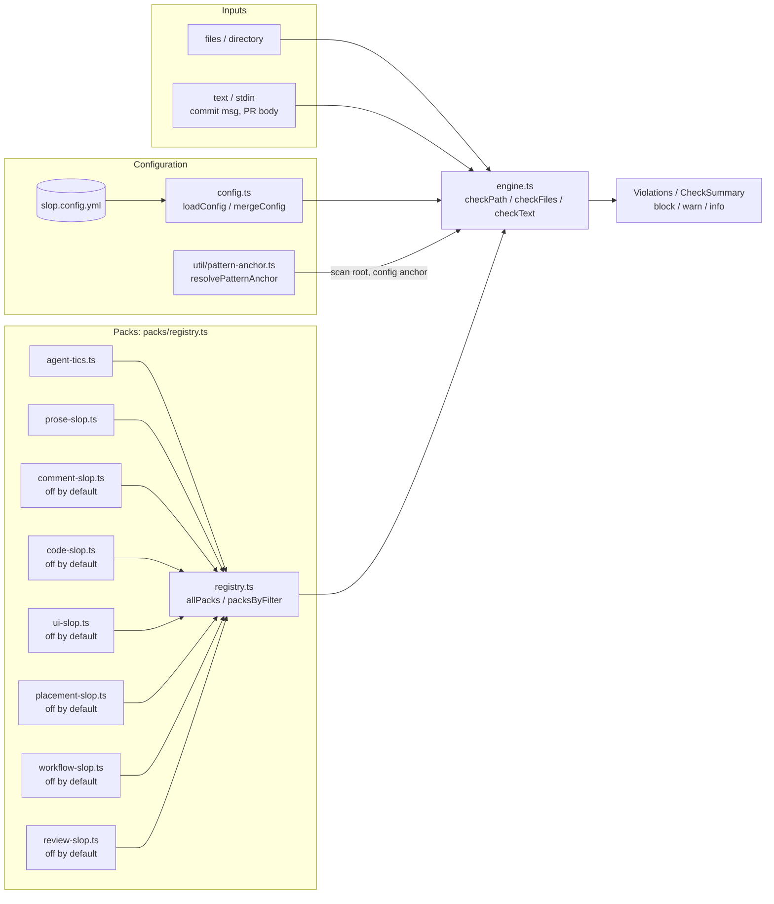
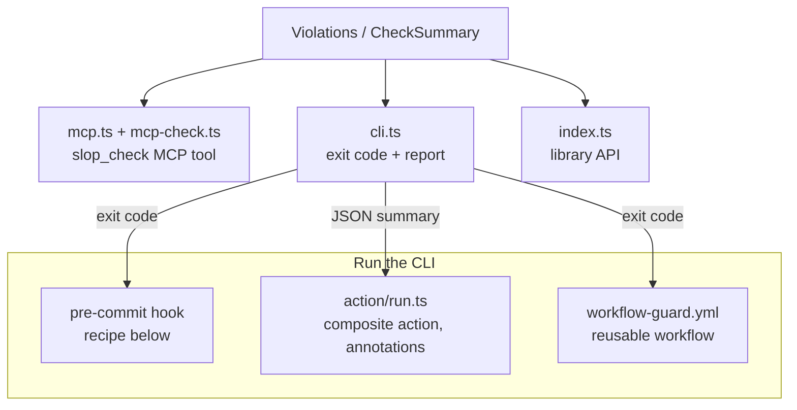

# Integration reference

Sample output, the scan pipeline, pre-commit and CI wiring (including the composite GitHub Action and the reusable workflow), the MCP server, the CLI reference, exit codes, and the pack roadmap. See the [README](../README.md) for the quick-start commands.

## What a run looks like

```
examples/slop-sample.md
  WARN  21:1  agent-tics/claude-code-footer  Auto-appended Claude Code attribution footer
  WARN  15:1  agent-tics/doubled-summary-heading  Second `Summary` heading in the same document
  WARN  19:1  agent-tics/placeholder-todo  Unresolved template placeholder
  WARN  12:42  prose-slop/em-dash  Em-dash in prose
  WARN  3:1  prose-slop/hedging-opener  Hedging opener `It is important to note that`
  WARN  3:40  prose-slop/marketing-adjectives  Empty marketing adjective `cutting-edge`
  WARN  3:121  prose-slop/delve-tapestry  LLM idiom `leverage the power of`
  WARN  7:42  prose-slop/delve-tapestry  LLM idiom `delve into`

1 files scanned, 20 violations (block 0, warn 20, info 0)
```

Output shortened: the CLI prints every violation, and each message ends with a fix hint that is cut here. The sample is `examples/slop-sample.md` at the repository root, scanned with `slop-detector check examples/slop-sample.md`.

`--explain` adds a one-line rationale per violation. Promote any rule to `block` per repo via `slop.config.yml`; the two `agent-tics` rules that catch leaked tool-call XML wrappers (`</result>`, `</invoke>`) ship as `block` by default since those are objectively wrong.

## Scan pipeline

The scan pipeline shows how slop-detector routes input through config, pattern-anchor and pack selection into the rule engine, which hands its result to the CLI, the MCP tool and the library API; the pre-commit hook, the composite action and the reusable workflow all run the CLI.

The first flowchart shows the path from input to violations.



The second flowchart shows the surfaces that consume the engine's result, and the three wrappers that run the CLI.



## Pre-commit recipe (Husky)

slop-detector is not on npm, so the hooks below call the built CLI by path. Build it first as in the README's [Install / quick start](../README.md#install--quick-start) section, and replace `<path-to-agent-dx>` with the absolute path of your agent-dx checkout. The bare `slop-detector` name works in hooks and npm scripts only where you have put the CLI on `PATH`; the README's shell alias covers interactive shells only.

Husky runs the commands in `.husky/pre-commit`:

```sh
node <path-to-agent-dx>/packages/slop-detector/dist/cli.js check .
```

For a faster, staged-files-only variant pair with [lint-staged](https://github.com/okonet/lint-staged) in `package.json`:

```json
{
  "lint-staged": {
    "*.md": "node <path-to-agent-dx>/packages/slop-detector/dist/cli.js check"
  }
}
```

lint-staged appends the staged file paths to the command; `check` accepts several paths, so they are scanned in one run.

## CI usage

```yaml
- name: Slop check
  run: |
    (cd packages/slop-detector && npm install && npm run build)
    node packages/slop-detector/dist/cli.js check . --format json > slop-report.json
```

For annotated pull request checks, use the composite action (see [GitHub Action](../README.md#github-action)). To run workflow-slop in another repository as its own job, use the reusable workflow (see [Use from another repo](workflow-slop.md#use-from-another-repo)).

This repository also runs a dedicated `review-guard` CI job. It builds this
package and runs `node packages/slop-detector/dist/cli.js check . --pack
review-slop --config slop.config.yml`; the root config documents the intentional
corpora and examples excluded from that whole-repository check.

## MCP server

slop-detector also ships a stdio [MCP](https://modelcontextprotocol.io) server (`bin`: `slop-detector-mcp`, entry point `dist/mcp.js`), so an agent can scan commit messages, PR bodies, and files as a native tool call instead of shelling out to the CLI.

It exposes one tool, `slop_check`:

| Param        | Type     | Notes                                                              |
| ------------ | -------- | ------------------------------------------------------------------ |
| `text`       | string   | In-memory string to scan. Mutually exclusive with `path`.          |
| `path`       | string   | File or directory to scan. Mutually exclusive with `text`.         |
| `filename`   | string   | Filename assumed for `text` input (prose-vs-code detection).       |
| `packs`      | string[] | Restrict to these packs; off-by-default packs only run when named. |
| `configPath` | string   | Path to a `slop.config.yml` / `.json`.                             |

It returns each violation as `SEVERITY line:col rule message`, grouped by file, plus a one-line tally.

Register it with your runtime by pointing at the built entry point:

```json
{
  "mcpServers": {
    "slop-detector": {
      "command": "node",
      "args": ["/absolute/path/to/slop-detector/dist/mcp.js"]
    }
  }
}
```

Run `npm run build` first so `dist/mcp.js` exists.

## CLI reference

`slop-detector check [paths...]` scans each file or directory it is given:

| Option | Default | Meaning |
| --- | --- | --- |
| `-c, --config <file>` | built-in defaults | Path to a `slop.config.yml` / `.json`. |
| `-p, --pack <pack>` | the packs enabled in the config (`agent-tics` and `prose-slop` without one) | Only run this pack. Repeat the flag, or pass a comma-separated list, for more than one. A named pack runs even when it is off by default. An unknown pack id exits `2`. |
| `-f, --format <fmt>` | `text` | `text` or `json`. |
| `--explain` | off | Print each rule's rationale alongside its violation. |
| `--stdin-path <path>` | `<stdin>` | Filename assumed for content read from stdin, used for prose-vs-code detection and path globs. |

Input rules:

- Several paths are scanned once each and folded into one result; the same file named twice (for example `a.md` and `./a.md`) is scanned once.
- No path, or a bare `-`, reads stdin. `--stdin-path` only names that content and never opens a file; passing it together with a path exits `2`.
- Stdin with nothing to read exits `2`: a TTY, `< /dev/null`, an empty pipe, or a pipe that carries only whitespace.
- A stdin that never writes a byte and never closes fails with the same error after a 10-second first-byte timeout. Set `SLOP_DETECTOR_STDIN_TIMEOUT_MS` to a positive number of milliseconds to change it. The timeout is cleared on the first chunk of data, so a producer that writes something and then stalls is not bounded.

`slop-detector list-rules [-f text|json]` prints every rule. The text format is one tab-separated line per rule (id, default severity, `on`/`off` by default, rationale); the JSON format is an array of objects with `rule`, `pack`, `defaultSeverity`, `enabledByDefault` and `rationale`.

`check --format json` prints one `CheckSummary` object, which the composite action parses:

```json
{
  "filesScanned": 1,
  "violations": [
    {
      "ruleId": "prose-slop/hedging-opener",
      "pack": "prose-slop",
      "severity": "warn",
      "path": "NOTE.md",
      "line": 1,
      "column": 1,
      "endLine": 1,
      "endColumn": 29,
      "message": "Hedging opener `It is important to note that` ...",
      "rationale": "...",
      "matched": "It is important to note that"
    }
  ],
  "blockCount": 0,
  "warnCount": 1,
  "infoCount": 0
}
```

`message` and `rationale` are shortened here. `endLine` and `endColumn` are optional per violation. A `warnings` array of configuration warnings (for example a glob that matched no file) is present only when it is non-empty.

## Exit codes

| Code | Meaning                                                                                 |
| ---- | --------------------------------------------------------------------------------------- |
| 0    | No `block`-severity violations. `warn` and `info` are reported but do not fail the run. |
| 1    | At least one `block`-severity violation.                                                |
| 2    | CLI usage or input error: a missing or invalid config, a path that does not exist, an unknown pack id, `--stdin-path` given together with a path, or stdin with nothing to read; or the report could not be written to stdout for a reason other than a closed reader (a full disk, a bad descriptor). |

A reader that closes early (`slop-detector check . -f json | head -c 10`) does not change the exit code: the run still ends with 0 or 1 by its verdict.

## Roadmap

- M1: `agent-tics` + `prose-slop` packs, CLI, config loader, per-line disables.
- M2: `comment-slop` + `code-slop` packs (TypeScript AST via `@typescript-eslint/parser`). Both off by default; opt in via config or `--pack`. Within-file analysis only for all rules except the two experimental cross-file rules (`code-slop/unused-export`, `code-slop/single-callsite-helper`), which require the corpus pre-pass (see [Cross-file rules](configuration.md#cross-file-rules-experimental)).
- M3: `ui-slop` v1 pack with 4 default-on warn rules (gradient text, purple+cyan palette, animated layout properties, skipped heading levels) and 2 default-off info rules (monospace-everywhere, flat type hierarchy). Regex-driven over CSS plus tag-shape scan for headings, no new dependencies. Tailwind class strings, JSX inline `style={{...}}` literals, headless-browser contrast/WCAG rules, and LLM-judged rules remain on the M3 backlog.
- `placement-slop`, `workflow-slop`, and `review-slop` shipped after M3; see [CHANGELOG.md](../CHANGELOG.md) for release notes from 0.3.1 on. The composite GitHub Action and the reusable `workflow-guard.yml` workflow are on `master` but not yet in a release (see `[Unreleased]` in the changelog), so pin a branch or commit SHA.

Track progress at [agent-dx](https://github.com/LanNguyenSi/agent-dx) issues and tasks.
